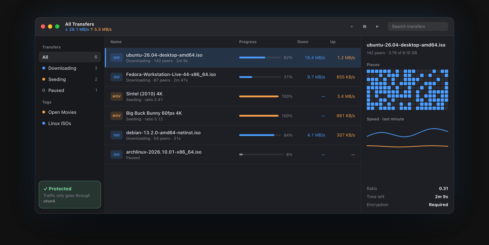
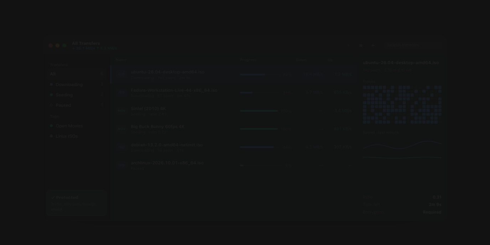
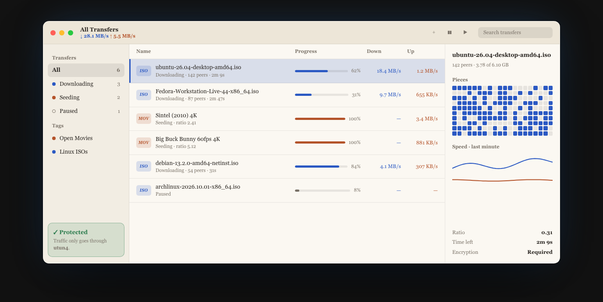

<div align="center">


# Peerbloom

**The private torrent client for Mac.**<br>
Free and open source. No ads, no accounts, no tracking. Ever.

<a href="https://github.com/EnigmaticZee/peerbloom/releases/latest/download/Peerbloom.dmg"></a>&nbsp;
<a href="https://enigmaticzee.github.io/peerbloom/"></a>

[](LICENSE)


[](https://github.com/EnigmaticZee/peerbloom/releases/latest)

<br>



</div>

<br>

## Why Peerbloom

Most torrent apps either look like they're from 2006 or come with ads and bundled junk. Peerbloom is a
native Mac app that's fast, private by design, and genuinely nice to use.

| Feature | What it does |
|---|---|
| 🛡️ **Locks to your VPN** | Bind to any active VPN. Peerbloom follows the tunnel through reconnects, and if it drops, traffic stops instead of leaking over your home connection. |
| 🙈 **Privacy mode** | One switch: VPN or SOCKS5 proxy only, encryption required, anonymous mode, and no local broadcasts or router port opening. |
| 🔍 **Know what peers see** | Shows the address peers report seeing, so you can confirm your VPN works, without asking any outside "what's my IP" service. |
| ⚠️ **Malware warnings** | Flags apps, installers, scripts and fakes like `movie.mp4.exe` before you download them, with one click to skip them. |
| 🔒 **Quarantine** | Every finished download gets the same quarantine mark as a Safari download, so macOS checks apps before they can run. |
| 🎬 **Watch while downloading** | Stream mode fetches pieces in order, so videos start playing right away. |
| 🎨 **Themes** | Six built-in themes, plus a Theme Maker that designs a new one from a few questions. |
| 🍎 **Feels like a Mac app** | Menu bar speeds, notifications, colour tags, a slow-mode schedule, and it pauses before your disk fills up. |

Under the hood it's [libtorrent](https://libtorrent.org), the same battle-tested engine behind qBittorrent
and Deluge, with a SwiftUI app on top.

## Install

1. [Download Peerbloom.dmg](https://github.com/EnigmaticZee/peerbloom/releases/latest/download/Peerbloom.dmg)
   and drag Peerbloom into Applications.
2. Peerbloom isn't signed with a paid Apple Developer ID, so the first time you open it macOS says it
   can't verify the app. Open it once and close the warning, then go to **System Settings › Privacy &
   Security**, scroll down, and click **Open Anyway**. You only do this once.

Prefer the Terminal? This does the same:

```bash
xattr -dr com.apple.quarantine /Applications/Peerbloom.app
```

Requires macOS 14 Sonoma or later on Apple silicon.

## Privacy, honestly

Peerbloom never collects or shares anything about you: no ads, no accounts, no analytics. Its only
internet traffic outside of torrenting is the IP blocklist download, and only if you turn it on.

BitTorrent itself is public: the peers you trade with can see your IP address. No app can change that
on its own. What Peerbloom does is make your own VPN or proxy watertight:

- **VPN binding:** choose *Any active VPN* in Settings › Network & Privacy. Peerbloom listens and
  connects only through the tunnel, follows it when it reconnects under a new name, and with a VPN
  app installed (NordVPN, Proton VPN, Mullvad, Tunnelblick, WireGuard and others) offers to open it
  when the VPN is off.
- **Privacy mode:** the strictest settings in one switch.
- **Proxy:** SOCKS5 or HTTP, with an optional login. The password is kept in the macOS Keychain.

Peerbloom doesn't include a VPN.

## Themes

<table>
<tr>
<td></td>
<td></td>
<td></td>
</tr>
<tr align="center"><td>Ocean</td><td>Paper</td><td>Terminal</td></tr>
</table>

Settings › Appearance has six built-in themes. To make your own, click **Copy Theme Maker** and paste it
into any AI assistant: it asks what you like and writes a `.peerbloomtheme` file. Double-click
the file to install it. Themes are colours and a font style only, checked for readable contrast, so they
can't run code. The format is in [Themes/README.md](Themes/README.md), and pull requests with new themes
are welcome.

## Build from source

You need Xcode (the Command Line Tools alone can't build SwiftUI apps on recent SDKs) and libtorrent
from Homebrew:

```bash
brew install libtorrent-rasterbar
```

Run straight from the source folder:

```bash
DEVELOPER_DIR=/Applications/Xcode.app/Contents/Developer swift run
```

Build a proper `Peerbloom.app` (needed for notifications and for opening magnet links and .torrent
files from other apps):

```bash
./scripts/bundle.sh
open build/Peerbloom.app
```

Build the drag-to-install DMG (`Peerbloom-1.0.dmg`, in the project folder):

```bash
./scripts/make-dmg.sh
```

Run the tests:

```bash
DEVELOPER_DIR=/Applications/Xcode.app/Contents/Developer swift test
```

The app icon is the Icon Composer document `Support/AppIcon.icon`, compiled into the app by
`scripts/bundle.sh`. The DMG background is drawn by `scripts/make-art.swift`; delete
`Support/dmg-background.tiff` to regenerate it.

### How it fits together

| Folder | What's there |
| --- | --- |
| `Sources/TorrentBridge` | Objective-C++ wrapper around libtorrent's C++ API |
| `Sources/Peerbloom/Engine` | `TorrentEngine`: runs bridge calls on a background queue and converts them to Swift types |
| `Sources/Peerbloom/Store` | `AppStore`: app state, polling, VPN binding and kill switch, disk guard, speed schedule, tags |
| `Sources/Peerbloom/Models` | Transfers, preferences, themes |
| `Sources/Peerbloom/Services` | Network interfaces, VPN apps, quarantine, risky-file checks, Keychain, themes, blocklists |
| `Sources/Peerbloom/Views` | SwiftUI: main window, sidebar, list, detail panel, Add sheet, menu bar, Settings |
| `Themes` | The Theme Maker prompt, the theme format, and example themes |
| `docs` | The website, served by GitHub Pages |

Peerbloom saves its state in `~/Library/Application Support/Peerbloom` and its settings in UserDefaults.

## Roadmap

See [ROADMAP.md](ROADMAP.md) for what's in version 1 and what's next: Shortcuts actions, a web
remote, RSS rules, watched folders and more.

## Contributing

Bug reports, ideas and pull requests are welcome. Please keep Peerbloom's promises in mind: no ads,
no tracking, no built-in torrent search, and nothing that sends user data anywhere.

## License

Peerbloom is free software under the [GNU General Public License v3.0](LICENSE). You can use, study,
share and change it. If you release a changed version, it has to stay open source under the same licence,
so no one can turn Peerbloom into a closed app with ads or tracking.

Peerbloom bundles [libtorrent](https://libtorrent.org) (BSD license) and [OpenSSL](https://www.openssl.org)
(Apache License 2.0). Their licence texts are in the app's About window.

<div align="center"><br><sub>Peerbloom is for sharing files you have the right to share: Linux releases, open movies, your own work.</sub></div>
